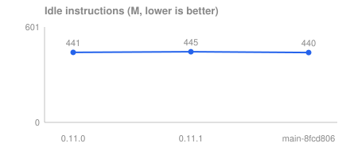
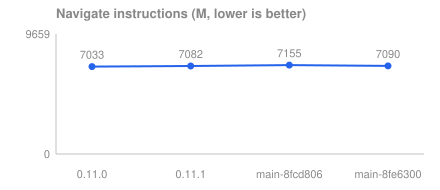
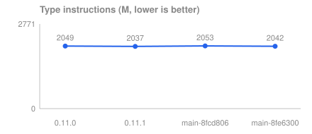
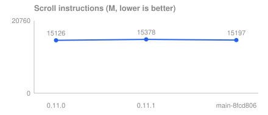
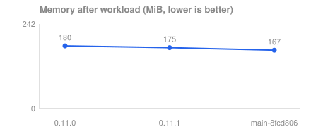
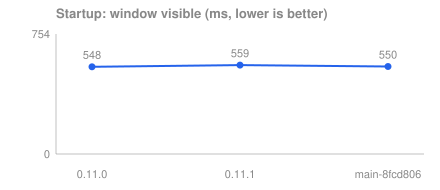

# Ghia benchmark history

The Mailbox app (`apps/ghia/src`, identical for every column) built against each Ghia version and measured with the same harness, so improvements in Ghia show up over time. Releases are the published `@ghia/solid` + `@ghia/native` as users install them; `main-<sha>` columns are snapshots of fdarian/ghia built from source. Columns run in semver order, then main snapshots by commit date. Generated by `bun harness/src/bench.ts history report`; do not edit by hand.

Each cell is the median over the sessions of that record, with the change against the previous column in parentheses (lower is better unless a row says otherwise). Every record also benchmarks the pinned Electron app back to back with Ghia: the Electron row is the machine-drift reference. Where Electron moved between columns, the machine state moved too, and Ghia's change is only meaningful relative to it.

## Headline: instructions and memory

Retired instructions and memory footprint are the stable measures across sessions.

| Metric | App | 0.11.0 | 0.11.1 | main-8fcd806 |
| --- | --- | ---: | ---: | ---: |
| Instructions, idle (millions) | Ghia | 441 | 445 (+0.9%) | 440 (-1.1%) |
| | Electron (reference) | 109 | 109 (+0.1%) | 109 (-0.3%) |
| Instructions, navigate (millions) | Ghia | 7033 | 7082 (+0.7%) | 7155 (+1.0%) |
| | Electron (reference) | 684 | 684 (+0.1%) | 686 (+0.4%) |
| Instructions, type (millions) | Ghia | 2049 | 2037 (-0.6%) | 2053 (+0.8%) |
| | Electron (reference) | 1219 | 1236 (+1.3%) | 1296 (+4.9%) |
| Instructions, scroll (millions) | Ghia | 15126 | 15378 (+1.7%) | 15197 (-1.2%) |
| | Electron (reference) | 4138 | 4099 (-1.0%) | 4114 (+0.4%) |
| Instructions, hover (millions) | Ghia | 1105 | 1032 (-6.6%) | 1059 (+2.6%) |
| | Electron (reference) | 367 | 369 (+0.4%) | 367 (-0.7%) |
| Memory at launch + 1 s (MiB) | Ghia | 128 | 128 (+0.3%) | 123 (-4.0%) |
| | Electron (reference) | 187 | 187 (-0.1%) | 187 (+0.1%) |
| Memory after idle (MiB) | Ghia | 128 | 128 (+0.1%) | 123 (-4.2%) |
| | Electron (reference) | 153 | 153 (-0.1%) | 153 (-0.1%) |
| Memory after workload (MiB) | Ghia | 180 | 175 (-2.8%) | 167 (-4.2%) |
| | Electron (reference) | 205 | 199 (-3.3%) | 198 (-0.5%) |

## Charts








## Startup, size and wakeups

| Metric | App | 0.11.0 | 0.11.1 | main-8fcd806 |
| --- | --- | ---: | ---: | ---: |
| Startup: window visible (ms) | Ghia | 548 | 559 (+1.9%) | 550 (-1.6%) |
| | Electron (reference) | 479 | 475 (-0.8%) | 478 (+0.6%) |
| App bundle (MiB) | Ghia | 131 | 131 (0.0%) | 131 (+0.3%) |
| | Electron (reference) | 261 | 261 (0.0%) | 261 (0.0%) |
| Main executable (MiB) | Ghia | 121 | 121 (0.0%) | 122 (+0.4%) |
| | Electron (reference) | 0.03 | 0.03 (0.0%) | 0.03 (0.0%) |
| Wakeups, idle (per s) | Ghia | 20.3 | 21.1 (+4.0%) | 20.8 (-1.4%) |
| | Electron (reference) | 69.4 | 69.8 (+0.6%) | 70.0 (+0.3%) |
| Wakeups, navigate (per s) | Ghia | 125 | 126 (+0.2%) | 127 (+0.6%) |
| | Electron (reference) | 255 | 255 (0.0%) | 255 (-0.1%) |
| Wakeups, type (per s) | Ghia | 63.6 | 65.9 (+3.7%) | 64.7 (-1.9%) |
| | Electron (reference) | 237 | 233 (-1.5%) | 240 (+2.9%) |
| Wakeups, scroll (per s) | Ghia | 153 | 220 (+43.9%) | 186 (-15.7%) |
| | Electron (reference) | 407 | 399 (-2.1%) | 403 (+1.3%) |
| Wakeups, hover (per s) | Ghia | 101 | 105 (+4.5%) | 109 (+4.0%) |
| | Electron (reference) | 175 | 183 (+4.7%) | 185 (+1.0%) |

## Machine-state sensitive: CPU and energy

CPU % and energy swing with the machine's state (frequency, thermals, background load) from one session to the next. Compare them only inside one session, i.e. against the Electron row of the same column.

| Metric | App | 0.11.0 | 0.11.1 | main-8fcd806 |
| --- | --- | ---: | ---: | ---: |
| CPU, idle (% of one core) | Ghia | 2.48 | 2.54 (+2.8%) | 2.48 (-2.5%) |
| | Electron (reference) | 1.49 | 1.58 (+5.8%) | 1.51 (-4.2%) |
| CPU, navigate (% of one core) | Ghia | 38.2 | 38.7 (+1.4%) | 39.5 (+2.0%) |
| | Electron (reference) | 13.6 | 14.7 (+8.3%) | 14.8 (+0.5%) |
| CPU, type (% of one core) | Ghia | 12.9 | 15.2 (+17.7%) | 16.0 (+5.2%) |
| | Electron (reference) | 13.2 | 14.3 (+8.6%) | 15.1 (+5.4%) |
| CPU, scroll (% of one core) | Ghia | 46.8 | 46.8 (0.0%) | 47.2 (+0.8%) |
| | Electron (reference) | 46.3 | 49.2 (+6.1%) | 53.3 (+8.4%) |
| CPU, hover (% of one core) | Ghia | 15.6 | 16.8 (+8.1%) | 16.4 (-2.4%) |
| | Electron (reference) | 10.4 | 11.1 (+6.4%) | 10.9 (-1.8%) |
| Energy, idle (mJ) | Ghia | 74.2 | 72.1 (-2.8%) | 72.6 (+0.8%) |
| | Electron (reference) | 9.08 | 7.56 (-16.7%) | 7.56 (0.0%) |
| Energy, navigate (mJ) | Ghia | 2058 | 2120 (+3.0%) | 1914 (-9.7%) |
| | Electron (reference) | 155 | 151 (-2.5%) | 154 (+2.0%) |
| Energy, type (mJ) | Ghia | 550 | 456 (-17.2%) | 440 (-3.5%) |
| | Electron (reference) | 291 | 287 (-1.2%) | 292 (+1.4%) |
| Energy, scroll (mJ) | Ghia | 5069 | 5052 (-0.3%) | 4446 (-12.0%) |
| | Electron (reference) | 1260 | 1214 (-3.6%) | 1015 (-16.4%) |
| Energy, hover (mJ) | Ghia | 241 | 191 (-20.7%) | 185 (-3.1%) |
| | Electron (reference) | 31.0 | 32.0 (+3.1%) | 29.9 (-6.4%) |

## Frame rate and latency

No entry has frame or latency data (every record ran with `--capture off`, which needs no Screen Recording permission).

## Notes

Every entry was recorded on the same machine setup (chip, macOS, display refresh rate, scroll bar setting) with the same capture mode.

## Entries

| Label | Source | Ghia sha | Recorded | Bench sha | Capture | Load 1 min before / after | Files |
| --- | --- | --- | --- | --- | --- | --- | --- |
| 0.11.0 | npm | – | 2026-11-05 | a5dd3e5 | off | 4.0 / 7.5 | [report](0.11.0.report.md), [json](0.11.0.json) |
| 0.11.1 | npm | – | 2026-11-05 | a5dd3e5 | off | 7.3 / 2.9 | [report](0.11.1.report.md), [json](0.11.1.json) |
| main-8fcd806 | source | 8fcd806 | 2026-11-05 | 5dd31ec | off | 4.5 / 8.6 | [report](main-8fcd806.report.md), [json](main-8fcd806.json) |

## Recording a new version

Record a version with the machine quiet (see the main README, "Running"), from a foreground terminal, in one session with the other versions you want to compare:

```
bun harness/src/bench.ts history record 0.11.1            # a published npm version
bun harness/src/bench.ts history record <git sha>         # a snapshot of fdarian/ghia, built from source
bun harness/src/bench.ts history report                   # regenerate this README and the charts
```

- `record` builds that Ghia into `dist/history/Mailbox-Ghia-<label>.app` with the current `apps/ghia/src` (npm versions install `@ghia/solid` and `@ghia/native` at exactly that version in a temp copy; a git sha goes through `scripts/setup-ghia.sh`, which leaves `vendor/ghia` at that revision), then runs the usual benchmark of Ghia and the pinned Electron app back to back and writes `history/ghia/<label>.json` and `<label>.report.md`.
- It takes `--rounds` and `--launches` (defaults 5 and 10, as for `run`) and `--capture auto|on|off`. Without Screen Recording use `--capture off`; the frame rate and latency rows then stay empty.
- The app never changes per version. If a version cannot build or run it, the entry says so with the reason and the history starts where the app works.
- With `GHIA_HEAVY` set to an executable lock script, the build and the measurement run under it, so no other heavy step shares the machine with a record. A git sha also needs `GHIA_SRC` (a Ghia checkout containing it) unless `vendor/ghia` already has it.
- The raw `results/` directory stays gitignored; commit `history/`.
